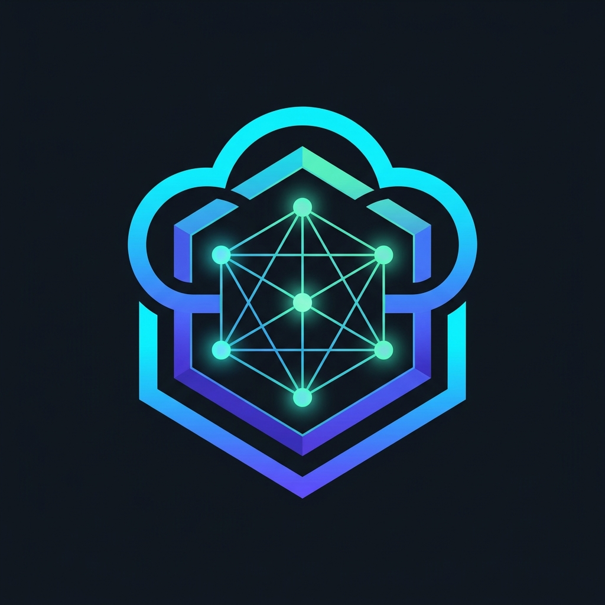

<p align="center">
  
</p>

# 🚀 Open Cloud Agents: Live-Fire Incident & Multi-Cloud IaC Sandbox

[](https://github.com/open-cloud-agents/demo/actions/workflows/kind-matrix.yml)
[](https://github.com/open-cloud-agents/demo/actions/workflows/guardrails.yml)
[](https://github.com/open-cloud-agents/ocagents)
[](LICENSE)

Welcome to the official **interactive demo sandbox** for [Open Cloud Agents](https://github.com/open-cloud-agents/ocagents). 

This repository allows platform engineers, SREs, and cloud architects to experience **autonomous multi-agent incident triage and multi-cloud IaC PR audits** live on Kubernetes (KinD) and Terraform across **AWS, GCP, and Azure** without modifying live production systems.

---

## ⚡ 60-Second Fast Track (Interactive Menu)

You don't need cloud credentials or a remote cluster. All you need is **Docker** and local tools.

```bash
# 1. Clone this demo repository:
git clone https://github.com/open-cloud-agents/demo.git
cd demo

# 2. Run the interactive live-fire incident drill:
./run-demo.sh
```

Choose from the interactive menu:
```text
  [1] ☸️  Kubernetes Outage Drill (KinD): SEV-2 Billing Pods (OOMKilled, 502, CrashLoop)
  [2] 🟧 AWS IaC PR Review: Pricing API Estate (ECS, ALB, RDS, Direct Ingress Bypass)
  [3] 🟦 GCP IaC PR Review: Secure Enclave (Cloud SQL Public IP, Ingress 0.0.0.0/0)
  [4] 🔷 Azure IaC PR Review: Enterprise Hub-Spoke (Storage State Destruction, NSG)
  [5] 🚀 Run Full Multi-Cloud Audit Suite
```

<p align="center">
  
</p>

---

## 🔬 Scenario Catalog

### 1. ☸️ Kubernetes SEV-2 Billing Outage Drill ([`scenarios/billing-service-outage/`](scenarios/billing-service-outage/))
* **Platform:** Kubernetes on KinD (Ephemerally provisioned)
* **The Failure:** A multi-service payment outage with HTTP 502 Bad Gateway responses.
* **The Invariants:**
  * `billing-cache`: **State 02** - `OOMKilled (Exit Code 137)` (Heap allocates 30MiB against 16MiB cgroup limit).
  * `billing-worker`: **State 09** - `CreateContainerConfigError` (Missing ConfigMap `billing-worker-config`).
  * `billing-api-service`: **State 17** - `Service has no endpoints` (Mismatched label selector `app: billing-api-v2`).

---

### 2. 🟧 AWS IaC: Pricing API Estate PR Review ([`scenarios/iac-aws-pricing-api/`](scenarios/iac-aws-pricing-api/))
* **Platform:** AWS (ECS Fargate, ALB, RDS PostgreSQL, VPC, Route 53, LocalStack)
* **The PR:** Developer branch `pr-feature-https-listener` intending to add HTTPS listener and redirect HTTP.
* **DevSecOps Reviewer Findings:**
  * 🔴 **CRITICAL (Perimeter Bypass):** Security group rule `api_task_inbound_https` exposes Fargate containers to `0.0.0.0/0:443`, bypassing the ALB.
  * 🔴 **HIGH (Insecure TLS):** `ssl_policy = "ELBSecurityPolicy-2016-08"` permits deprecated TLS 1.0/1.1 protocols.
  * 🔴 **HIGH (Audit Loss):** Deletion of `s3.tf` destroys the access logging bucket while health check logging remains enabled.
* **Local Simulation:** Compatible with LocalStack (`scenarios/iac-aws-pricing-api/localstack/docker-compose.yml`).

---

### 3. 🟦 GCP IaC: Secure Enclave & Private Cloud SQL ([`scenarios/iac-gcp-secure-enclave/`](scenarios/iac-gcp-secure-enclave/))
* **Platform:** Google Cloud Platform (VPC, Cloud NAT, Cloud SQL PostgreSQL, Cloud Storage)
* **The PR:** Developer branch `pr-developer-fast-track` adding remote debugging connectivity.
* **DevSecOps Reviewer Findings:**
  * 🔴 **CRITICAL (Firewall Exposure):** Firewall rule `fw-enclave-allow-public-debug` allows inbound `0.0.0.0/0` on PostgreSQL (5432) and SSH (22).
  * 🔴 **CRITICAL (Cloud SQL Public IP):** `ipv4_enabled = true` with authorized networks `0.0.0.0/0` and weak SSL mode.
  * 🔴 **HIGH (Public Data Exfiltration):** Cloud Storage bucket grants `roles/storage.objectViewer` to `allUsers`.

---

### 4. 🔷 Azure IaC: Enterprise Hub-Spoke & Flexible PostgreSQL ([`scenarios/iac-azure-enterprise-hub-spoke/`](scenarios/iac-azure-enterprise-hub-spoke/))
* **Platform:** Microsoft Azure (Hub VNet, Delegated Subnets, PostgreSQL Flexible Server, Storage)
* **The PR:** Developer branch `pr-developer-hotfix` connecting monitoring tools.
* **DevSecOps Reviewer Findings:**
  * 🔴 **CRITICAL (State Destruction Trap):** Renaming `storage_account_name` from `stpricingprodeu2` to `stpricingprodeu2v2` triggers `forces replacement`, permanently destroying the storage account and all blobs!
  * 🔴 **CRITICAL (NSG Management Bypass):** NSG rule allows `SourceAddressPrefix = "0.0.0.0/0"` to ports `3389` (RDP) and `22` (SSH).
  * 🔴 **HIGH (Public Endpoint Exposure):** `public_network_access_enabled = true` on the Flexible PostgreSQL database.

---

## 🤖 Running Autonomous Agent Triage

Use the [`ocagents`](https://github.com/open-cloud-agents/ocagents) CLI:

```bash
# 1. Run Kubernetes Incident Triage in KinD:
ocagents sandbox --scenario scenarios/billing-service-outage/ --keep-cluster
ocagents run --task "Diagnose and resolve all failing pods and ingress 502s in namespace demo-billing"

# 2. Audit the AWS Terraform PR:
ocagents run --task "Audit Terraform PR in scenarios/iac-aws-pricing-api/pr-feature-https-listener"

# 3. Audit the GCP Terraform PR:
ocagents run --task "Audit Terraform PR in scenarios/iac-gcp-secure-enclave/pr-developer-fast-track"

# 4. Audit the Azure Terraform PR:
ocagents run --task "Audit Terraform PR in scenarios/iac-azure-enterprise-hub-spoke/pr-developer-hotfix"
```

---

## 🛡️ Multi-Version KinD CI Pipeline

This demo repository includes automated GitHub Actions testing across a Kubernetes version matrix:

* **Kubernetes `v1.31.0`**
* **Kubernetes `v1.30.2`**
* **Kubernetes `v1.29.4`**

Check the live status under [`.github/workflows/kind-matrix.yml`](.github/workflows/kind-matrix.yml).

---

## 📚 Ecosystem & References

* **Core Framework:** [open-cloud-agents/ocagents](https://github.com/open-cloud-agents/ocagents)
* **Official Documentation:** [open-cloud-agents.github.io/ocagents](https://open-cloud-agents.github.io/ocagents/)
* **Reusable Actions:** [open-cloud-agents/pipelines](https://github.com/open-cloud-agents/pipelines)
* **Author:** Ibrahim Jimoh ([LinkedIn](https://www.linkedin.com/in/ijimoh))
* **License:** Apache 2.0
